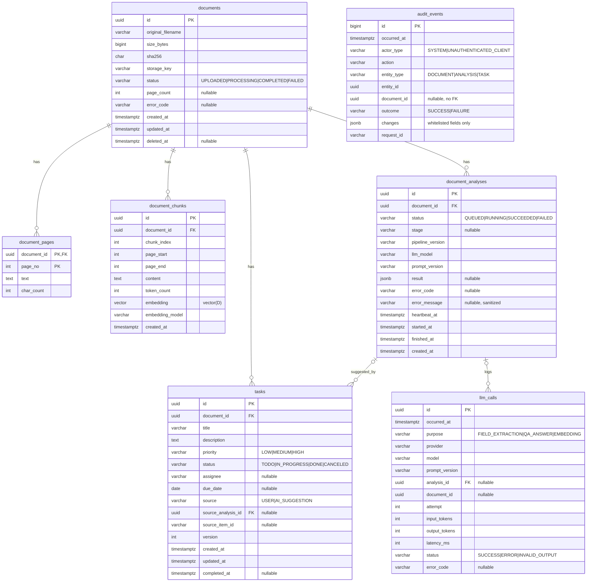

# 03. 데이터베이스 설계 (ERD 초안)

> 상태: M0 초안 (2026-10-16) · 실제 스키마의 정본은 `migrations/`(Alembic)이며 이 문서는 설계 의도를 기록한다.

## 1. 핵심 결정

| 질문 | 결정 | 이유 |
|---|---|---|
| 문서 ↔ 분석 관계 | **1:N** | 재분석(모델·프롬프트 변경) 시 이전 결과를 비교·감사할 수 있어야 함. "최신 결과"는 `created_at DESC LIMIT 1` |
| 재실행 시 이전 결과 | **보존** | `prompt_version`, `llm_model`을 함께 저장해 결과 차이의 원인 추적 |
| 청크 소유 | 문서 단위 (최신 색인만 유지) | QA는 항상 최신 색인 사용. 청킹 실험은 운영 테이블이 아닌 `eval/` 하네스에서 수행 |
| 분석 결과 저장 | `JSONB` | 필드 구성이 프롬프트 버전과 함께 진화하고, 항상 통째로 읽음. 필드 단위 조회(예: 만료 임박 계약)가 필요해지면 해당 필드만 컬럼으로 승격 |
| 상태 값 타입 | `VARCHAR + CHECK` | PostgreSQL `ENUM`은 값 추가/삭제 마이그레이션이 번거로움 |
| `task_histories` / `ai_logs` | `audit_events` 1개 테이블 + `llm_calls` | 문서 이력 API가 문서·분석·Task 이벤트를 한 번에 시간순으로 조회 → 단일 테이블이 단순. LLM 호출 로그는 성격(운영 지표)이 달라 분리 |
| 문서 삭제 | 소프트 삭제 + 콘텐츠 즉시 제거 | 아래 4절 |
| PK | `UUID` (감사 이벤트만 `BIGINT IDENTITY`) | 외부 노출 ID 추측 방지, 대량 append 테이블은 정렬 가능한 정수 |

## 2. ERD



## 3. 테이블 상세

### documents
| 제약/인덱스 | 내용 | 목적 |
|---|---|---|
| CHECK | `size_bytes > 0`, `status IN (...)`, `char_length(sha256)=64` | 잘못된 데이터 차단 |
| UNIQUE (부분) | `(sha256) WHERE deleted_at IS NULL` | 동일 파일 중복 업로드 감지 → `409` + 기존 ID 반환. 삭제 후 재업로드는 허용 |
| INDEX (부분) | `(created_at DESC) WHERE deleted_at IS NULL` | 목록 조회 기본 정렬 |
| INDEX (부분) | `(status, created_at DESC) WHERE deleted_at IS NULL` | 상태 필터 목록 |

**문서 상태 전이**

```
UPLOADED ──▶ PROCESSING ──▶ COMPLETED
                 │   ▲          │
                 ▼   │          │ (재분석)
               FAILED ──────────┘─▶ PROCESSING
```
허용: `UPLOADED→PROCESSING`, `PROCESSING→COMPLETED|FAILED`, `FAILED→PROCESSING`(재시도), `COMPLETED→PROCESSING`(재분석). 그 외는 `domain/document_status.py`에서 `InvalidStateTransition` 예외.
`documents.status`는 "최신 분석 실행"의 상태를 요약한 값이며 정본은 `document_analyses`다. 두 값은 Service에서 같은 트랜잭션으로 갱신한다.

### document_pages
- PK `(document_id, page_no)`, `ON DELETE CASCADE`, CHECK `page_no >= 1`
- 용도: 추출 결과 추적(빈 페이지 감지), **인용문 원문 대조 검증**. 원문이므로 문서 삭제 시 즉시 제거.

### document_chunks
- UNIQUE `(document_id, chunk_index)`, CHECK `page_start <= page_end`, `ON DELETE CASCADE`
- INDEX `(document_id)` — 검색은 항상 문서 범위 → 해당 문서 청크만 정확 거리 계산
- 벡터 차원 `D`는 임베딩 모델 결정 후 M3 마이그레이션에서 확정. 모델을 바꾸면 차원이 바뀌므로 `embedding_model` 컬럼으로 혼용을 감지한다.
- HNSW 인덱스는 문서 간 검색 기능이 생길 때 추가.

### document_analyses
- **부분 유니크 인덱스** `(document_id) WHERE status IN ('QUEUED','RUNNING')` — 문서당 진행 중 분석 1개를 DB가 보장
- INDEX `(document_id, created_at DESC)` — 최신 결과/이력 조회
- `stage`: `EXTRACTING → CHUNKING → EMBEDDING → INDEXING → FIELD_EXTRACTION` (실패 지점 추적)
- `ON DELETE CASCADE`

### tasks
- CHECK: `status`, `priority` 값 / `source = 'USER' OR source_analysis_id IS NOT NULL` / `(status = 'DONE') = (completed_at IS NOT NULL)`
- UNIQUE (부분) `(source_analysis_id, source_item_id) WHERE source_analysis_id IS NOT NULL` — 같은 AI 제안을 두 번 등록 방지
- INDEX `(document_id, status)`, `(assignee, status)`, `(due_date) WHERE status IN ('TODO','IN_PROGRESS')`
- `version`: 낙관적 잠금. `UPDATE … WHERE id=? AND version=?` 결과 0행이면 `409`

**Task 상태 전이**

| From \ To | TODO | IN_PROGRESS | DONE | CANCELED |
|---|---|---|---|---|
| TODO | — | ✅ | ❌ | ✅ |
| IN_PROGRESS | ✅ | — | ✅ | ✅ |
| DONE | ❌ | ✅ (재개) | — | ❌ |
| CANCELED | ✅ (복구) | ❌ | ❌ | — |

### audit_events
- **append-only** (UPDATE/DELETE 하지 않음). `document_id`에 FK를 걸지 않아 문서가 영구 삭제돼도 이력은 남는다.
- INDEX `(document_id, occurred_at)`, `(entity_type, entity_id, occurred_at)`
- `changes` 예: `{"status": {"from": "TODO", "to": "IN_PROGRESS"}}` — 허용 목록 필드만 기록. 계약 원문, 질문, 답변, 인용문은 기록하지 않는다.
- actions: `DOCUMENT_UPLOADED, DOCUMENT_DELETED, ANALYSIS_REQUESTED, ANALYSIS_STARTED, ANALYSIS_SUCCEEDED, ANALYSIS_FAILED, TASK_CREATED, TASK_UPDATED`

### llm_calls
- 프롬프트/응답 본문 미저장. 토큰·지연·상태만.
- INDEX `(occurred_at)`, `(purpose, occurred_at)` — 기간별 p95·오류율 집계

## 4. 삭제 및 보존 정책

| 데이터 | `DELETE /documents/{id}` 시 | 보존 기간 |
|---|---|---|
| documents 행 | `deleted_at` 설정 (API에서 404) | 영구 삭제(purge)는 후순위 |
| 원본 PDF | 커밋 후 즉시 삭제 | — |
| document_pages, document_chunks(+임베딩) | 같은 트랜잭션에서 즉시 삭제 | — |
| document_analyses | 유지하되 API 접근 불가 (인용문 포함 → purge 대상) | purge 시 삭제 |
| tasks | 유지하되 API 접근 불가 | purge 시 삭제 |
| audit_events | 유지 | 1년 (정책값, 자동 정리는 후순위) |
| llm_calls | 유지 | 90일 (정책값) |

- 분석이 `RUNNING`인 문서는 삭제 불가(`409`) — 실행 중인 작업이 삭제된 청크를 다시 쓰는 경쟁 조건 방지.
