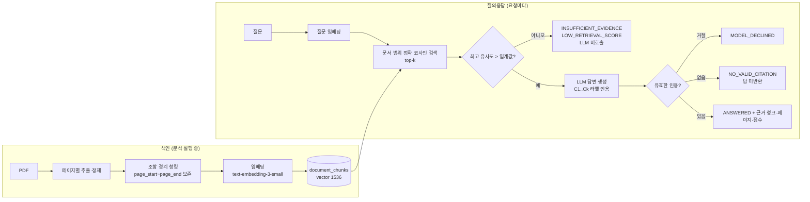

# 09. M3 RAG 구현 기록

> 작성: 2026-11-09 · 브랜치 `feature/m3-rag`

## 1. 파이프라인

| 단계 | 모듈 | 입력 → 출력 |
|---|---|---|
| 청킹 | `app/pipeline/chunker.py` | `list[PageText]` → `list[Chunk(index, page_start, page_end, content)]` |
| 임베딩 | `app/llm/embeddings.py` | `list[str]` → 벡터 목록 (OpenAI / Fake) |
| 색인 | `app/rag/indexer.py` | 청크 + 벡터 → `document_chunks` 교체 (한 트랜잭션) |
| 검색 | `app/rag/retriever.py` | 질문 벡터 → `RetrievedChunk(score)` 상위 k개 |
| 답변 | `app/rag/answerer.py` | 질문 + 청크 → `AnswerOutput(answerable, answer, cited_chunks)` |
| 판정 | `app/services/qa_service.py::resolve_answer` | 모델 출력 → 최종 상태 (서비스·평가 공용) |

## 2. 설계 결정

| 결정 | 이유 |
|---|---|
| **pgvector + 문서 범위 정확 검색 (ANN 인덱스 없음)** | 질문은 항상 한 문서(수십~수백 청크) 범위. `(document_id, chunk_index)` 유니크 인덱스로 범위를 좁힌 뒤 정확한 거리 계산이 빠르고 정확하다. HNSW에 문서 필터를 걸면 탐색 후 필터링 때문에 k개보다 적게 나올 수 있다. 문서 간 검색이 생기면 HNSW 추가 |
| 별도 VectorDB 대신 pgvector | 문서 삭제 시 청크·벡터를 **같은 트랜잭션**에서 지울 수 있다 (분산 삭제·고아 벡터 없음) |
| 조항 경계 우선 청킹 | 계약 질문은 대부분 특정 조항에 관한 것. "제N조"에서 새 청크를 시작해 조항이 쪼개지지 않게 한다 |
| 청크마다 페이지 범위 보존 | 답변 근거에 원문 페이지를 표시하기 위해 |
| `embedding_model` 컬럼 + 불일치 시 409 | 모델이 바뀌면 벡터 공간이 달라 거리 비교가 무의미하다 |
| **2단계 근거 판단** | ① 검색 점수가 임계값 미만이면 LLM을 부르지 않는다 (비용·환각 방지) ② 모델이 거절하거나 실제로 넘긴 청크를 인용하지 않으면 답을 돌려주지 않는다 |
| 유사도 점수 ≠ 정확성 | 점수는 "주제가 비슷하다"는 신호다. 응답 스키마 설명에 명시하고, 답변의 근거 일치는 평가셋으로 따로 측정 |
| 청크 라벨(`C1`)로 인용 | UUID를 모델에 노출하지 않고, 서버가 라벨 → 청크 매핑으로 검증 |
| 질문·발췌문 구획 태그 무력화 | `</question>` 같은 문자열로 구획을 탈출하는 인젝션 방지 (단위 테스트) |
| 구조화 출력 흐름 공통화 | 추출과 질의응답이 같은 "호출 → 검증 → 1회 교정" 흐름을 쓴다 (`llm/structured.py`) |
| 분석 파이프라인 버전 `m3-v1` | 색인이 없는 이전 분석 결과를 재사용하지 않도록 (이후 M7 인젝션 표시 추가로 `m7-v1`) |

## 3. 검증 결과

| 항목 | 결과 (2026-11-09) |
|---|---|
| 자동 테스트 (Fake LLM·Fake 임베딩, 실제 PostgreSQL + pgvector 0.6.2) | 전체 227 passed (M3 추가: 청킹·임베딩·답변 입력 단위 15, 색인 통합 4, 질의응답 통합 15) |
| 실제 OpenAI live 테스트 (`tests/live/test_openai_rag.py`) | **2 passed** (2026-11-26, `gpt-5-mini`). 해지 질문은 제7조를 인용해 답하고, 문서에 없는 질문(준거법·관할)은 거절 |
| 검색·답변 품질 평가 | Recall@3 1.0, 답할 수 있는 질문 답변률·인용 적중률 100%, 문서에 없는 질문 거절률 87.5%, p95 10.6s — [docs/evaluation.md](../evaluation.md) |

live 테스트를 처음 실행했을 때 해지 질문 테스트가 실패했다. 테스트가 "제7조 청크가 **1위**"를 요구했는데, 실측에서 제7조는 계약서 서두 청크(0.3474)와 0.006 차이로 **2위**(0.3418)였다. 서비스는 top-k 청크를 모두 LLM에 넘기므로 1위일 필요가 없다. 이 테스트는 작성 당시 API 키 문제로 한 번도 실행되지 않아 이 가정이 검증되지 않았던 것이다. 기준을 "검색 결과 안에 제7조가 있고, 답변이 제7조를 인용한다"로 바꾸었다. 평가에서도 벡터 검색의 Recall@1은 0.72~0.75, Recall@3은 0.97~1.0이었다.

## 4. 한계

- 재정렬(reranking)은 넣지 않았다. 평가에서 top-3 안에 정답 근거가 100% 들어와 현재 데이터로는 이득이 확인되지 않았다. 하이브리드(벡터 + BM25) 검색은 1위 적중률이 0.75 → 0.875로 높았지만, 같은 설정으로 40문항 답변 평가를 다시 돌리자 답변 품질 지표가 모두 같았다(top-3를 함께 넘기므로). 측정된 이득이 없어 도입하지 않았다 — [evaluation.md 4.3](../evaluation.md#43-하이브리드-검색은-답변-품질을-바꾸는가).
- 질문 하나에 문서 하나만 대상으로 한다. 여러 계약서를 가로지르는 검색은 범위 밖이다.
- 대화 맥락(이전 질문)을 기억하지 않는다.
- 질문·답변 본문은 저장하지 않는다 (호출 메타데이터만 기록). 질의 이력 기능이 필요하면 보존 정책과 함께 추가해야 한다.
